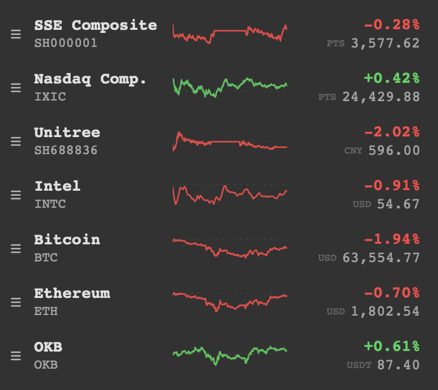

# StockWidget

**English** | [简体中文](README.zh-CN.md)

**A lightweight, easy-to-configure desktop market widget for macOS.** Follow stocks, indices, and crypto in one compact panel with prices, percentage changes, and sparklines.

Native SwiftUI + AppKit · Apple silicon · macOS 14+ · MIT license

<p align="center">
  
</p>

An actual app capture using live market data, with concise English display names. Prices are a snapshot of the capture time and may be delayed by providers.

## Features

- **Lightweight and native.** SwiftUI + AppKit, with no third-party package dependencies.
- **Easy configuration.** Search by name or symbol, pick a market, and add it. Included public feeds need no app account or API key.
- **Multiple markets.** US stocks, A-shares, Hong Kong stocks, mainland indices, Nasdaq Composite / Nasdaq-100, and crypto.
- **Compact layout.** Drag handles to reorder, resize the panel, and use magnetic alignment near screen edges and desktop widgets. The height follows your list; lists longer than ten rows scroll.
- **Your preferences.** English / Chinese, 1 / 5 / 15-minute refresh, rising-price colors, optional always-on-top, and optional launch at login.
- **Considerate background behavior.** Slower polling while hidden, paused automatic refresh on lock/sleep, and cached prices when a request fails. The app does not prevent Mac sleep.

StockWidget is a standalone desktop window with a menu bar icon. It stays on the Space where it opens and does not follow desktop switches or join other apps' full-screen Spaces. It is not a WidgetKit extension; a numbered Space is not reserved across relaunches.

## Install

1. Download **StockWidget-macOS-arm64.zip** from the [latest release](https://github.com/weilii/StockWidget/releases/latest).
2. Unzip it and move **StockWidget.app** to **Applications**.
3. Open the app. Its chart icon appears in the menu bar.

The downloadable build requires **Apple silicon and macOS 14 or later**. Intel Macs have not been tested.

The app is locally signed and is not Apple-notarized. If macOS blocks the first launch, verify the download source, then use **System Settings → Privacy & Security → Open Anyway**. See [Apple's instructions](https://support.apple.com/en-us/102445).

## Set up your watchlist

The app starts with an empty list; the screenshot is an example you can recreate.

1. Choose **menu bar icon → Add symbol**, right-click the panel, or press **⌘N**.
2. Enter a company name or symbol, narrow the market if needed, and click **Add**.
3. Drag the **≡ handle** at the left of a row to reorder. Drag a name, chart, price, or background margin to move the window. A normal click opens details; right-click to remove a symbol.

Try the seven symbols shown above:

| Instrument | Search for | Display unit |
| --- | --- | --- |
| Shanghai Composite | `SH000001` | PTS |
| Nasdaq Composite | `IXIC` or `^IXIC` | PTS |
| Unitree | `688836` or `SH688836` | CNY |
| Intel | `INTC` | USD |
| Bitcoin | `BTC` | USD / USDT |
| Ethereum | `ETH` | USD / USDT |
| OKB | `OKB` or `OKB-USDT` | USDT |

For OKB, use **Automatic** or **OKX** as the crypto source. `SH000001` is the Shanghai index; `SZ000001` is Ping An Bank. Nasdaq Composite (`IXIC`) and Nasdaq-100 (`NDX`) are separate indices. Normal searches retain names supplied by data providers; the screenshot uses English example labels.

Open **menu bar icon → Settings** or press **⌘,** to configure:

| Setting | Options |
| --- | --- |
| Interface language | English / 简体中文 |
| Refresh interval | 1 / 5 / 15 minutes |
| Price colors | Green up / red down, or red up / green down |
| Crypto source | Automatic / Coinbase / Binance / OKX |
| Always on top | Float above other windows on the same desktop |
| Launch at login | Optional; off by default |

**⌘R** refreshes. **⌘W** hides the panel and keeps the menu bar app running. Use the menu bar icon to show it again or quit. Install in Applications before enabling launch at login.

## Data and privacy

| Market | Source |
| --- | --- |
| US stocks and supported Nasdaq indices | Yahoo Finance chart endpoint, unofficial |
| A-shares, mainland indices, and Hong Kong stocks | Tencent quote / minute endpoints, unofficial |
| Crypto | Coinbase, Binance, and OKX public market data |

Automatic crypto mode can switch the complete price/chart group between sources; manually selected sources stay explicit. USD, USDT, CNY, HKD, and index points are labeled distinctly. Stocks use previous-close changes; crypto uses rolling 24-hour changes. Click a row for its source and quote timestamp.

Refresh frequency is a request schedule, not a guarantee of fresh data. Feeds may be delayed, unavailable, or changed by providers. Market-hour estimates do not include a complete holiday calendar. Regional access varies; some networks may require a VPN. **Settings → Test connections** helps check your current network. Use of market data remains subject to its providers' terms.

The app has no application backend or analytics. Watchlist, order, settings, and cached prices are saved locally in:

```text
~/Library/Application Support/StockWidget/state.json
```

## Build from source

Requires **Swift 6+** and a macOS SDK from Xcode or Command Line Tools. No paid Apple developer membership is needed to build and run locally.

```sh
git clone https://github.com/weilii/StockWidget.git
cd StockWidget
zsh scripts/build-app.sh
open dist/StockWidget.app
```

For architecture, checks, and screenshot reproduction, see the [development guide](docs/DEVELOPMENT.md). Bug reports and improvements are welcome through [GitHub Issues](https://github.com/weilii/StockWidget/issues) and pull requests.

## License

[MIT](LICENSE).
