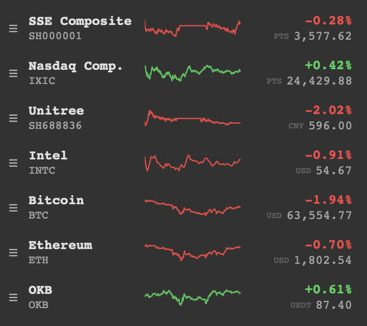

# StockWidget

[English](README.md) | **简体中文**

**轻量、易配置的 macOS 桌面行情小插件。** 在一张紧凑面板里查看股票、指数和加密货币的价格、涨跌幅与迷你走势图。

SwiftUI + AppKit 原生开发 · Apple silicon · macOS 14+ · MIT 开源

<p align="center">
  
</p>

截图来自应用实际运行，使用真实行情和简短英文名称。价格仅代表截图时刻，数据源可能存在延迟。

## 功能特点

- **轻量原生**：采用 SwiftUI + AppKit，没有第三方软件包依赖。
- **配置简单**：按名称或代码搜索，选择市场，点击添加。内置公开行情源无需应用账号或 API Key。
- **多市场混排**：支持美股、A 股、港股、沪深指数、纳斯达克综合／100 指数，以及加密货币。
- **紧凑易调整**：拖动手柄排序，调整窗口宽度，靠近屏幕边缘或桌面组件时磁性对齐。窗口高度随列表变化，超过十行时滚动。
- **按习惯配置**：支持中英文、1／5／15 分钟刷新、红涨绿跌或绿涨红跌、可选置顶和登录时启动。
- **常驻时减少打扰**：隐藏时降低请求频率，锁屏或休眠时暂停自动刷新，网络失败时保留缓存。应用不会阻止 Mac 休眠。

StockWidget 是带菜单栏图标的独立桌面小窗口。它留在启动时所在的桌面，不跟随切换桌面，也不加入其他应用的全屏桌面。它不是 WidgetKit 扩展，重启应用后不会绑定之前的具体桌面编号。

## 安装

1. 在 [最新 Release](https://github.com/weilii/StockWidget/releases/latest) 下载 **StockWidget-macOS-arm64.zip**。
2. 解压，将 **StockWidget.app** 拖入 **应用程序**。
3. 打开应用，菜单栏中会出现走势图图标。

下载版本要求 **Apple silicon 芯片及 macOS 14 或以上**。尚未在 Intel Mac 上验证。

应用使用本地签名，尚未通过 Apple 公证。如果 macOS 首次启动时拦截，请确认下载来源后，在 **系统设置 → 隐私与安全性 → 仍要打开** 中放行。参见 [Apple 官方说明](https://support.apple.com/en-us/102445)。

## 配置自选列表

首次启动时列表为空，可以按下面的示例自行添加。

1. 点击 **菜单栏图标 → Add symbol／添加标的**，右键面板，或按 **⌘N**。
2. 输入名称或代码，需要时选择市场，然后点击 **Add／添加**。
3. 拖动每行左侧的 **≡ 手柄** 调整顺序；拖动名称、曲线、价格或窗口空白处移动窗口。普通点击打开详情，右键可删除标的。

截图中的七个标的：

| 标的 | 搜索代码 | 显示单位 |
| --- | --- | --- |
| 上证指数 · Shanghai Composite | `SH000001` | PTS（点） |
| 纳斯达克综合指数 · Nasdaq Composite | `IXIC` 或 `^IXIC` | PTS（点） |
| 宇树科技 · Unitree | `688836` 或 `SH688836` | CNY |
| 英特尔 · Intel | `INTC` | USD |
| 比特币 · Bitcoin | `BTC` | USD／USDT |
| 以太坊 · Ethereum | `ETH` | USD／USDT |
| OKB | `OKB` 或 `OKB-USDT` | USDT |

添加 OKB 时，加密货币来源请选择 **Automatic／自动** 或 **OKX**。`SH000001` 是上证指数，`SZ000001` 是平安银行；纳斯达克综合指数（`IXIC`）与纳斯达克100指数（`NDX`）也属于不同标的。正常搜索保留行情源提供的名称，截图单独使用了英文示例名称。

通过 **菜单栏图标 → Settings／设置** 或 **⌘,** 调整：

| 设置 | 可选项 |
| --- | --- |
| 界面语言 | English／简体中文 |
| 刷新间隔 | 1／5／15 分钟 |
| 涨跌颜色 | 绿涨红跌／红涨绿跌 |
| 加密货币来源 | 自动／Coinbase／Binance／OKX |
| 始终置顶 | 浮于同一桌面的其他窗口上方 |
| 登录时启动 | 可选，默认关闭 |

**⌘R** 手动刷新；**⌘W** 隐藏面板并保留菜单栏运行。通过菜单栏图标可重新显示或退出应用。启用登录时启动前，请先将应用安装到“应用程序”。

## 行情与隐私

| 市场 | 来源 |
| --- | --- |
| 美股及已支持的纳斯达克指数 | Yahoo Finance chart 接口，非正式接口 |
| A 股、沪深指数及港股 | 腾讯报价／分时接口，非正式接口 |
| 加密货币 | Coinbase、Binance、OKX 公开行情 |

自动模式允许整组切换加密货币的价格和曲线来源，手动指定来源时不会静默切换。USD、USDT、CNY、HKD 和指数点数分别标示；股票涨跌以前收盘价为基准，加密货币采用滚动 24 小时口径。点击标的可查看来源及实际报价时间。

刷新间隔代表请求频率，不保证上游报价同样新鲜。接口可能延迟、暂时不可用或发生变更；交易时段估计未覆盖完整节假日日历。不同地区的访问情况不同，部分网络可能需要 VPN，可通过 **设置 → 检测连接** 检查当前网络。行情数据的使用仍受各来源的条款约束。

应用没有自建后端或分析统计，自选、排序、设置和行情缓存保存在本机：

```text
~/Library/Application Support/StockWidget/state.json
```

## 从源码构建

需要 **Swift 6+**，以及 Xcode 或 Command Line Tools 提供的 macOS SDK。本地构建及运行无需付费 Apple 开发者账号。

```sh
git clone https://github.com/weilii/StockWidget.git
cd StockWidget
zsh scripts/build-app.sh
open dist/StockWidget.app
```

项目结构、检查命令和截图复现方法见 [开发说明（英文）](docs/DEVELOPMENT.md)。欢迎通过 [GitHub Issues](https://github.com/weilii/StockWidget/issues) 或 Pull Request 反馈和改进。

## 许可证

[MIT](LICENSE)。
